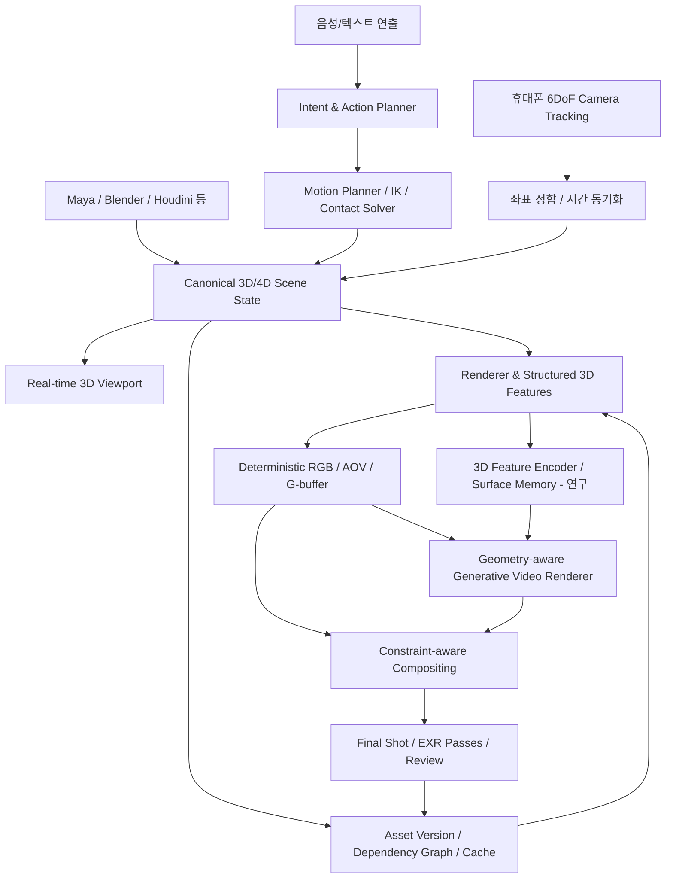

# SceneForge — 3D-Native Generative Production 전략 및 연구 로드맵

> **North Star**  
> SceneForge는 **3D 제작 데이터의 편집 가능성과 수정 재현성을 유지하면서**, 음성으로 복수 인물·에셋의 행동을 연출하고 휴대폰으로 촬영한 카메라 움직임을 결합해, 생성형 모델로 최종 영상을 완성하는 **3D-native AI production system**을 지향한다.

**문서 목적:** 이 대화에서 도출한 판단을 향후 제품 설계, 모델 연구, 기술 검증, 개발 우선순위의 기준으로 정리한다.  
**주의:** 아래의 `[확정 원칙]`은 대화에서 정리한 지향점이지 구현 완료를 뜻하지 않는다. `[설계 제안]`과 `[미결정]`은 실험 및 팀 논의를 통해 확정한다.

---

## 0. Executive Summary

### 반드시 가져갈 두 가지 능력

1. **3D-native, constraint-preserving generative rendering**  
   Mesh, rig, material, groom, facial controls, animation, camera, lighting, 객체 ID 등 **3D 제작 데이터 자체가 영속적으로 남아야 한다**. 생성 모델은 단순히 3D를 렌더링한 RGB/MP4를 참조하는 수준을 넘어 **기하·재질·표면 대응·객체 관계 등 구조적 3D 정보를 조건으로 활용**해야 한다. 감독이 지정한 세부 속성은 필요할 때 결정적으로 보존할 수 있어야 한다.
2. **Speech-directed, multi-actor 4D editing**  
   음성 명령을 여러 인물·에셋의 **명시적인 pose sequence, motion, contact event, object transform**으로 변환하고, 별도 휴대폰 모듈에서 취득한 **6DoF camera pose sequence**와 하나의 시간축에서 동기화한다. 생성된 영상에서도 객체의 identity와 동작·카메라 제어가 유지되어야 한다.

### 한 줄 전략

**3D를 AI 영상 생성용 프리비즈 도구로 취급하지 않는다. 3D가 제작의 Source of Truth이고, 생성 모델은 그 위에서 선택적으로 동작하는 렌더러다.**

### 제품 및 연구의 구분

- **제품 핵심:** 음성·카메라로 지시할 수 있고, 자산·샷·타임라인이 계속 편집 가능하며, 기존 VFX/DCC 환경과 왕복할 수 있는 제작 시스템.
- **모델 핵심:** 알려진 3D scene state와 artist-authored constraints를 영상에 충실하게 반영하는 생성형 렌더링.
- **운영 핵심:** 바뀐 것만 다시 계산하고, 바뀌지 않은 것은 유지하는 versioning, dependency graph, cache 및 review workflow.

---

## 1. 문제 정의: 기존 제작 파이프라인과 AI 비디오 생성 사이의 간극

### 1.1 전통적인 3D/VFX 파이프라인이 제공하는 가치

`Preproduction → 3D Asset 구축(Modeling / Texturing / Rigging / Groom / CFX) → Shot Animation/Layout → Lighting & Rendering → Compositing → Review/Revision`

- 디테일한 geometry, 표정, 재질, 털, 동작, 카메라를 **어느 시점에든 지정·수정**할 수 있다.
- 객체와 에셋이 shot 간에 재사용되고 변경 이력을 관리할 수 있다.
- deterministic rendering을 중심으로 **수정 범위와 결과의 예측 가능성**이 높다.
- 반면 여러 부서 간 핸드오프, 무거운 렌더링, 반복 승인 때문에 변경 비용과 리드타임이 크다.

### 1.2 2D 중심 AI 비디오 파이프라인의 가치와 한계

- 장점: 빠른 탐색, 스타일 변화, 촬영되지 않은 디테일 생성, 낮은 초기 제작 비용.
- 한계: 픽셀/비디오만 출력되면 객체별 원본 데이터와 편집 의도가 소실되기 쉽다.
- 감독이 헤어 길이, 안면 표정, 특정 인물의 접촉 동작처럼 **정확한 속성**을 수정했을 때, 모델이 이를 따르도록 반복 생성하는 일은 3D 파이프라인의 확정적 편집과 다르다.
- 시드 고정이나 참조 영상만으로 편집 결과의 픽셀 단위 재현성이 보장되지는 않는다.

### 1.3 Autodesk Flow Studio와의 경계

Autodesk의 공개된 **3D Editor → Canvas** 워크플로에서는 편집 가능한 3D 장면을 만들어 렌더링된 영상을 Canvas에 전달하고, Seedance와 같은 생성 모델이 해당 영상을 **composition/animation reference**로 사용한다. 이는 유용한 3D 지향 워크플로이지만, 공개 튜토리얼에 나타난 **생성 모델과의 인터페이스**는 렌더된 비디오를 중심으로 한다. **Flow Studio에 3D 수정 기능이 없다는 뜻은 아니다.** [참고 1, 2]

SceneForge의 목표 차별화는 다음과 같다.

| 질문 | 일반적인 3D→참조 영상→AI 비디오 | SceneForge 목표 |
|---|---|---|
| 최종 생성까지 유지할 데이터는? | 렌더된 샷/참조 이미지가 중심 | **버전 관리되는 3D/4D scene state** |
| 특정 인물만 수정하면? | 참조를 갱신하고 결과를 재생성 | 인물·시간 구간별 의존성을 갱신하고 나머지는 가능한 한 유지 |
| 모델이 객체를 구별하는 근거는? | 영상 특징/마스크에 크게 의존 | persistent actor ID + rig + surface/part ID + motion/contact 정보 |
| 재질·털·표정 정확도가 절대적이면? | 프롬프트·참조 준수에 의존할 수 있음 | 결정적 3D 렌더/합성으로 잠그거나 검증을 통과해야 함 |
| 감독의 수정 명령은 어디에 남는가? | 노드 설정/프롬프트/참조 영상 | **구조화된 action/event + scene layer/shot override** |

---

## 2. 핵심 제품 원칙 (Non-negotiables)

1. **3D is Source of Truth.** 최종 MP4는 결과물이지 원본 제작 데이터가 아니다.
2. **3D-native conditioning.** RGB 프리비즈만을 유일한 생성 입력으로 삼지 않는다. 적어도 geometry-derived structured conditions를 전달하고, 직접적인 3D feature 입력의 필요성과 효과를 실험한다.
3. **Art-directability over plausible generation.** '그럴듯함'보다 우선하는 지정 사항은 기하·동작·재질·카메라 차원에서 검증할 수 있어야 한다.
4. **Persistent identity.** 인물이 교차하거나 가려져도 actor ID, object ID, surface correspondence가 장면 상태와 생성 조건에서 유지되어야 한다.
5. **Non-destructive editing.** 음성 명령, 수동 수정, 샷별 override가 원본을 덮어쓰지 않도록 layer/version을 사용한다.
6. **Deterministic and generative lanes coexist.** 모든 픽셀을 생성 모델에 맡기지 않는다. 정확도 요구에 따라 확정적 렌더 패스와 생성 패스를 결합한다.
7. **One timeline, multiple representations.** 월드/샷/카메라/관절/접촉/생성 결과/승인 버전을 동일 시간축에 연결한다.
8. **Production interoperability.** 초기에 Maya, Houdini, Blender, Unreal 등을 대체하기보다 데이터를 입출력하고 기존 제작 결과를 보존한다.

### 오해하면 안 되는 기술적 구분

- **3D 정보를 모델에 넣는 것 ≠ 3D 정보를 모델이 항상 정확히 따르는 것.** 강한 보존 요구는 렌더링/합성 단계의 보장과 별도 검증이 필요하다.
- **2D 이미지 격자에 담긴 조건 ≠ 단순 RGB 참조.** World Position, Normal, Tracking/UV, Instance ID 등의 G-buffer는 3D 의미를 포함한 구조화된 신호다. 다만 단일 시점 G-buffer만으로 가려진 표면 전체와 자산의 모든 속성을 전달할 수는 없다.
- **Editable 4D ≠ 임의의 4D Gaussian을 자유롭게 리깅/편집 가능.** 편집의 기본 단위는 리깅 가능한 객체, 관계, 시간별 상태여야 한다.
- **재현 가능한 편집 ≠ 생성 픽셀 완전 동일.** 정확히 고정할 출력은 결정적 렌더와 캐시/합성으로 보호해야 한다.

---

## 3. 목표 사용자 경험과 최우선 데모

### 3.1 대표 시나리오

1. 아티스트가 **2명의 리깅된 캐릭터, 테이블, 컵, 실내 세트**를 배치한다.
2. 감독이 말한다.  
   > “A가 B에게 다가가 악수하고, B는 왼손에 든 컵을 테이블에 내려놔.”
3. SceneForge는 명령을 **actor별 action events, root/joint trajectories, contact constraints, object transforms**로 컴파일한다.
4. 감독이 휴대폰을 들고 이동해 가상 카메라의 **6DoF trajectory**를 녹화한다.
5. 3D viewport에서 동작·상호작용·카메라 구도를 **즉각적으로 프리뷰**한다.
6. 결정적 render passes + 3D-aware generative rendering으로 최종 샷을 만든다.
7. 감독이 말한다.  
   > “B가 오른손으로 악수하도록 바꿔. 카메라와 A의 동작은 유지해.”
8. 시스템은 **B의 제약 및 영향을 받는 동작/접촉만 갱신**하고, 변경 불필요한 샷 데이터와 보호된 출력은 유지한다. 최종 영상은 수정된 3D 상태로부터 다시 생성/합성한다.

**데모 합격의 본질:** 같은 장면을 다시 생성하는 것뿐 아니라, **무엇을 수정했고 무엇을 보존했는지 시스템이 설명하고 실제로 확인할 수 있어야 한다.**

### 3.2 MVP 범위

**포함**
- 1개 실내 세트, 리깅된 인물 2명, 소품 1~2개, 카메라 1대.
- 음성/텍스트 명령 → 구조화된 동작 이벤트 → 3D pose sequence.
- 휴대폰 6DoF 카메라 입력, 좌표 정합, 타임스탬프 정렬 및 재생.
- actor ID, 접촉 이벤트, 월드 좌표, 장면/샷 상태 저장 및 수정 이력.
- 실시간 3D viewport 프리뷰와 **오프라인/준오프라인** 생성형 최종 렌더.
- RGB 프리비즈 외에 **구조화된 3D 조건**을 생성 모델에 전달하는 실험.
- 한 객체/한 동작만 수정한 뒤 before/after 비교 및 export.

**초기 범위에서 제외**
- 완전 자동 모델링·리깅·CFX·Groom 제작, DCC 소프트웨어 전체 대체.
- 처음부터 별도 foundation video model 학습.
- 최종 생성 영상까지 즉시 30–60 FPS 출력하는 완전 실시간 neural generation.
- 수십 명의 군중, 장시간 연속 영상, 모든 종류의 사실적인 물리 상호작용.
- 모든 머티리얼/모든 형상의 신경 렌더러 기반 픽셀 완전 보장.

---

## 4. 제안 아키텍처



### 4.1 Canonical 3D/4D Scene State — 핵심 데이터 모델

**[설계 제안]** OpenUSD 중심의 persistent scene description을 검토한다. 계층별 layer, asset reference, variant, shot override는 기존 VFX 파이프라인과 자연스럽게 연결된다. 단, USD만으로 리깅 솔버/시뮬레이터가 완성되는 것은 아니다. [참고 7]

최소 상태 구성:

| 데이터 | 예시 속성 | 불변식 / 목적 |
|---|---|---|
| `Asset` | mesh, topology/UV, material, groom, rig, versions | 원본 및 버전 식별 |
| `ActorInstance` | persistent actor ID, asset ref, skeleton state | 인물별 정체성/애니메이션 분리 |
| `ObjectInstance` | object ID, transform, attachment | 소품 소유/접촉 상태 |
| `MotionClip/Event` | action type, joint trajectory, timing, constraints | 음성 편집의 재현 가능한 결과 |
| `ContactGraph` | actor/hand ↔ object/hand, frame interval | 악수·컵 잡기·가림 관계 검증 |
| `CameraTrack` | 6DoF pose, intrinsics, fps, timestamps | 실물 카메라 연출의 가상 장면 정합 |
| `Shot` | time range, lighting, overrides, render mode | 샷 단위 승인/렌더/재작업 |
| `Dependency/Version` | asset revision, model version, seed, pass hash | 영향 범위 계산 및 비교 가능한 재생성 |

**좌표계 계약:** world scale/unit, up axis, handedness, camera extrinsics/intrinsics, timestamp 기준을 명시해야 한다. 휴대폰 AR 추적 좌표계와 SceneForge world 좌표계를 변환하며 드리프트와 tracking loss를 기록한다.

### 4.2 Voice → Structured Action → Pose Sequence

음성 LLM이 모든 관절 프레임을 직접 생성하는 구조보다 다음 파이프라인을 우선 검증한다.

`Speech → Intent/Entity Resolution → Temporal Action Graph → Motion Generation/Retargeting → IK/Contact/Collision → Pose Sequence → Validation`

- **Entity resolution:** “A”, “B”, “그 컵”, “오른손”을 persistent ID와 rig part로 해석.
- **Temporal logic:** `before`, `after`, `while`, 정확한 frame/second offset을 표현.
- **Motion synthesis:** 모션 라이브러리 + 생성형 motion model의 역할 구분.
- **Physical constraints:** 양손 접촉, 소품 파지, 발 접지, 충돌 회피.
- **Human-in-the-loop:** 애매한 지시만 짧게 되묻고, 나머지는 즉시 3D preview로 확인.

음성 수정 이벤트 예시(개념 스키마):

```json
{
  "shot_id": "shot_003",
  "operation": "change_contact_effector",
  "actor_id": "actor_B",
  "target_actor_id": "actor_A",
  "contact_event_id": "handshake_01",
  "new_effector": "right_hand",
  "preserve": ["camera_track", "actor_A_root_motion", "set_layout"],
  "recompute": ["actor_B_motion", "contact_constraints", "dependent_render_passes"]
}
```

이 데이터가 저장되어야 Undo/Redo, shot variant, revert, 승인 히스토리, 협업이 가능해진다.

### 4.3 Mobile Camera → 3D Camera Track

- 카메라의 위치/회전뿐 아니라 intrinsics, focus/lens 정보(가능하면), 추적 품질, timestamp를 저장.
- 기기 추적 좌표계와 SceneForge 장면 좌표계의 정합을 명시하고, scale 및 origin을 캘리브레이션.
- 물리 카메라 이동과 가상 카메라 이동의 매핑(1:1 / gain / smoothing / retiming)을 분리.
- 기존 **Unreal VCam + Live Link**를 구현 비교 기준으로 사용. [참고 8]

### 4.4 Rendering의 두 가지 경로

**A. Deterministic 3D Lane**
- 정확한 Mesh/Rig/Camera/Material을 사용해 RGB, depth, normal, motion vector, instance ID, material AOV, shadow, alpha 등 필요 패스를 계산.
- 중요 형상/텍스처/표정 등은 렌더 패스를 **보호된 출력**으로 확정.

**B. Generative Rendering Lane**
- 3D 조건 + appearance reference + 필요시 audio/text를 사용해 사실감, 미세 질감, 보조 효과를 생성.
- 생성 자유도를 **속성별·객체별·영역별·시간별**로 제한.
- 하드 제약을 침범하는 영역은 재생성 대신 deterministic lane으로 fallback/합성.

**중요:** hair boundary, transparency, reflection, shadow처럼 서로 다른 렌더 경로가 만나는 곳은 합성 난제이므로, 단순 mask copy만으로 품질이 보장되지 않는다. AOV/deep compositing 및 경계 정합을 검증해야 한다.

### 4.5 수정 제약의 세 단계

| 제약 수준 | 예시 | 원칙 | 합격 기준 예시 |
|---|---|---|---|
| **Hard-locked** | 제품 형상, 로고, 중요 얼굴 형태, 확정 카메라 | 결정적 렌더/합성으로 보호 | 보호 패스의 픽셀/기하 변화가 없거나 정의된 오차 이내 |
| **Geometry-locked** | 두 인물의 동작, 손-컵 접촉, 가림 순서 | 구조적 3D condition + 제약 검증 | 포즈/접촉/객체 ID 지표 통과 |
| **Generative** | 배경 미세 디테일, 비핵심 texture, 분위기 | 제한된 생성 자유도 | 시각적 품질 및 시간적 안정성 확인 |

---

## 5. 핵심 연구 질문: 3D를 비디오 모델에 어떤 형태로 전달할 것인가?

> **Main RQ:** 이미 알려진 3D 객체의 identity, geometry, motion, material, camera trajectory를 어떠한 표현으로 Video Generative Model에 주입해야 **복수 객체 제어·외형 보존·수정 재현성**을 가장 효과적으로 달성할 수 있는가?

**연구 가설**

- **H1:** 단순 RGB 프리비즈보다 world position, surface tracking, normal, instance ID를 포함한 조건이 카메라/동작/identity 준수를 개선할 것이다.
- **H2:** 2D G-buffer에 **3D object/surface feature 또는 persistent memory**를 추가하면 시점 변화와 가려짐 이후의 identity 및 외형 일관성이 개선될 것이다.
- **H3:** 생성 모델에 모든 픽셀을 맡기는 방식보다 **constraint-aware deterministic/generative compositing**이 정확한 샷 수정에 유리할 것이다.
- **H4:** 음성→직접 비디오보다 **음성→구조화 action/contact graph→pose sequence→video**가 복수 인물의 편집 재현성을 높일 것이다.

### 5.1 비교해야 할 조건 인터페이스

| 실험군 | 입력 | 목적 |
|---|---|---|
| **A. RGB reference baseline** | 참조 이미지 + 렌더된 프리비즈 MP4 | Flow Studio형 비교 기준 |
| **B. Structured G-buffer** | A + depth/normal/world position/instance mask/tracking | 공간·표면 의미를 가진 conditioning의 효과 |
| **C. Direct 3D features** | B + object/rig/mesh/surface feature tokens | 보이지 않는 면·영속적 객체 표현의 추가 효과 |
| **D. Hybrid + constraints** | C + protected AOV/mask + compositing policy | 최종 수정 가능성과 정확도 보존 효과 |

**의사결정 기준:** C가 B보다 의미 있게 향상되지 않으면 무거운 3D encoder를 처음부터 도입하지 않는다. 반대로 H2가 성립한다면 object-centric 3D feature memory를 SceneForge의 핵심 연구 자산으로 개발한다.

### 5.2 평가해야 할 조건 (minimum benchmark)

**장면/동작 축**
- 두 인물 교차 및 가려짐 → 재등장.
- 악수(좌/우 손 교체), 컵 잡기/내려놓기, 시선/표정 변경.
- 정적 카메라, 이동 카메라, 인물 주위 orbit, 급격한 카메라 회전.
- 소재 변경(의상 색/재질, 털 길이/형상 등): soft generation으로 가능한 범위와 hard-lock 필요 범위 구분.

**지표**

| 평가 축 | 검증 방법 |
|---|---|
| Identity consistency | actor ID switch / actor별 appearance 일관성 / 가려짐 후 재식별 |
| Pose fidelity | 목표 joint trajectory를 projection한 2D keypoint와 생성 영상 추정 keypoint 오차 |
| Camera adherence | 목표 카메라 궤적에 따른 정적 배경 특징의 재투영 일치, 전문가 평가 |
| Contact & object state | 손-물체 접촉 타이밍/위치, 접촉 전후 소품 transform 일관성 |
| Geometry/material fidelity | 렌더 참조 대비 geometry silhouette, material/texture 및 고정 속성 유지 |
| Edit locality | 변경 요청 영역 밖의 영상 차이 및 시간적 안정성 |
| Rendering cost | VRAM, latency, GPU 시간, 변경당 재계산 비율 |
| Perceptual quality | 플리커/얼굴 품질/영상 자연스러움에 대한 블라인드 평가 |

측정치를 선언하기 전에 테스트셋, camera calibration, ground-truth/annotation 수준을 먼저 정의한다. **일반적인 FVD 단독으로 성공을 판단하지 않는다.**

### 5.3 연구 참고점

- **DAR (2026):** animated mesh로부터 **tracking + world position + normal**의 neural 4D G-buffer를 주입하는 4D renderer 연구. 직접적인 B→C 설계 비교의 출발점. [참고 3]
- **4Director (2026):** rigid object mesh와 trajectory를 scene에 유지하지만 생성 모델에는 depth video를 활용하는 접근. scene control과 appearance preservation을 분리해서 살펴볼 사례. [참고 4]
- **TRON (2026):** 3D Gaussian/PBR/조명 제어와 neural renderer를 결합한 연구. material/lighting control 연구 트랙에 적합. [참고 5]
- **DiffusionRenderer (CVPR 2025):** geometry/material/lighting 관련 렌더 조건과 video diffusion을 연계한 연구. [참고 6]
- **DanceTogether! (2025):** 복수 인물 identity와 각 pose stream의 결합을 다루는 연구. 연구 H4의 비교 참고점. [참고 9]

위 연구들은 **서로 다른 문제 설정**을 가지고 있으며 어느 하나가 SceneForge의 전체 요구조건을 이미 해결했다는 뜻은 아니다.

---

## 6. 전체 제작 워크플로: Pre → Production → Post의 통합

| 단계 | SceneForge가 관리할 것 | 아티스트의 편집 지점 | 출력/승인 단위 |
|---|---|---|---|
| **Preproduction** | script, storyboard, shot plan, asset references, blocking | 대사/동작 의도, 인물 배치, 컷 길이 | shot plan / blocking version |
| **Production** | 리깅된 asset, canonical scene, action graph, phone camera take, lighting, shot overrides | 관절·접촉·카메라·장면 속성 | 버전된 4D shot state |
| **Postproduction** | deterministic AOV, structured conditions, generative output, comp, QC | 마스크/재질/외형/합성/디테일 | EXR passes + final shot + provenance |
| **Revision Loop** | 의존성 추적, patch, 캐시, 비교, 승인 이력 | 음성 또는 DCC에서 부분 변경 | 변경 이력과 before/after |

**핵심 UX:** 아티스트가 “다시 생성” 버튼을 누르는 시스템이 아니라, “이 3D 상태를 어떤 범위에서 수정할 것인가”를 지정하고 **영향 받은 결과만 다시 계산하는** 시스템.

---

## 7. 단계별 실행 로드맵 (초안 / 일정은 리소스 확인 후 확정)

### Phase 0 — 제품 정의와 측정 기준 고정

**구현 대상**: 2 actor + 1 prop + 1 room + 1 camera의 5~10초 샷.  
**산출물**: 장면 데이터 스키마 v0, 성공/실패 데모 스크립트, 정량·정성 평가 프로토콜.  
**Exit criterion**: 어떤 속성을 수정·보호해야 하는지, 프리뷰와 최종 렌더의 책임을 명시한다.

### Phase 1 — Editable 3D Core + Voice-directed Motion

- 임포트한 rigged actor에 persistent ID 할당.
- 음성 명령을 구조화된 action/event와 pose sequence로 변환.
- IK/contact graph를 통해 악수와 컵 내려놓기를 프리뷰에서 수행.
- shot/asset versioning + undo/revert + 타임라인 오버라이드 구현.

**Exit criterion**: actor B의 접촉 손을 수정해도 지정된 카메라, 배경, A의 root motion 원본이 유지되는 것을 3D scene state에서 확인한다.

### Phase 2 — Mobile Camera Integration + Deterministic Rendering

- 모바일 6DoF 추적과 SceneForge world calibration.
- FPS/timecode 동기화, tracking loss/드리프트 대응.
- viewport와 녹화된 카메라 take를 동일하게 재생.
- RGB + depth/normal/world position/instance ID/tracking 등 필요한 render pass 출력.

**Exit criterion**: 동일한 저장된 scene + camera state로 동일한 카메라 경로와 구조화된 render pass를 복원할 수 있다.

### Phase 3 — 3D-aware Video Model Baselines

- A/B/C 조건 인터페이스를 공통 데이터셋/모델/해상도 조건에서 비교.
- 복수 인물 교차/접촉/카메라 회전 테스트.
- identity, pose, camera, material fidelity 및 latency 평가.

**Exit criterion**: RGB reference 대비 구조적 3D 조건의 실제 이득과 비용을 측정해 다음 모델 구조를 결정한다. 이득이 불분명하면 복잡한 3D encoder를 보류한다.

### Phase 4 — Constraint-aware Generative Rendering + Partial Edit

- 객체/속성별 hard-lock, geometry-lock, generative policy 구현.
- 생성 경로와 AOV/합성 경로를 함께 사용.
- dependency invalidation과 before/after 비교 UI 도입.
- DCC 왕복 export와 최종 shot / AOV / state bundle 출력.

**Exit criterion**: 음성 수정 이후 **보호할 정보는 보호하면서** 최종 샷을 다시 생성하고, 어떤 부분이 변경되었는지 보여주는 end-to-end 데모.

### 초기 2주에 먼저 할 일 (실행 가능한 백로그)

- [ ] **North Star 데모 샷 고정:** 인물 A/B, 테이블/컵, 악수, 카메라 orbit, 손 변경 시나리오.
- [ ] **Canonical state 스키마 v0 작성:** actor ID, event, contact, camera take, shot revision.
- [ ] **기존 렌더 엔진 선정:** Blender 또는 Unreal 중 현재 팀이 빠르게 실험 가능한 쪽으로 결정.
- [ ] **Phone camera prototype:** 6DoF pose 저장/재생 + world alignment 오차를 기록.
- [ ] **음성→동작 structured output:** 한 문장 → action graph → 간단한 rigged 애니메이션.
- [ ] **기준 실험 준비:** RGB MP4 condition과 G-buffer condition을 동일한 5~10초 샷으로 생성할 데이터 export.
- [ ] **평가 시트 정의:** actor identity, pose, camera, contact, edit locality, latency.
- [ ] **경쟁 제품 직접 테스트:** Flow Studio에서 3D 장면 수정 → Canvas 재생성 시 원본 자산과 최종 결과가 어떻게 관리되는지 기록.

---

## 8. 주요 위험과 기술적 대응

| 위험 | 왜 중요한가 | 대응 / 검증 |
|---|---|---|
| 생성 모델이 3D condition을 무시 | 감독이 수정한 속성이 결과에 반영되지 않음 | condition strength 실험 + constraint metric + deterministic fallback |
| 3D feature encoder의 비용 | 고해상도 장시간 영상에서 GPU/메모리 증가 | G-buffer baseline 대비 개선폭으로 도입 여부 결정 |
| occlusion 이후 identity drift | 여러 인물/자산의 정체성 손상 | actor/instance ID + surface tracking + feature memory 실험 |
| 접촉 동작의 물리 불일치 | 악수/컵 동작이 실제로 성립하지 않음 | contact graph + IK/retargeting + 이벤트 시간 검증 |
| 휴대폰 tracking drift 및 좌표 오차 | 실제 촬영 의도와 가상 샷 불일치 | calibration, relocalization, time sync, 품질 로그 |
| hair/alpha/reflection의 경계 | 3D-생성 합성의 일관성 저하 | AOV/deep pass, boundary-aware composite 연구 |
| 재생성의 비결정성 | revert/edit 후 승인된 샷 일부가 달라짐 | 모델/시드/설정/자산 버전 기록 + 캐시 + 보호된 렌더 영역 |
| DCC와 SceneForge 사이 데이터 손실 | 실제 VFX 파이프라인에 못 들어감 | OpenUSD/FBX/Alembic 등 범위를 명시하고 왕복 테스트 |
| 프로젝트 범위 과대 | 월드 생성·모션·영상 foundation 모델을 동시에 구현 | 초기에는 기존 모델/엔진 재사용, 한 샷의 vertical slice 완성 |

---

## 9. 지금 확정할 것과 아직 열어둘 것

### 대화에서 도출된 핵심 제품 원칙 — 유지

- **3D 자산과 편집 가능성을 최종 생성보다 상위에 둔다.**
- **여러 actor와 object를 명시적인 pose/motion/contact sequence로 제어한다.**
- **휴대폰 6DoF 카메라 시퀀스를 장면과 같은 시간축에 입력한다.**
- **프리프로덕션–프로덕션–포스트프로덕션을 관통하는 재편집 가능한 workflow를 지향한다.**
- **최종 영상의 외형 품질과 감독의 수정 정확성을 별개 평가 항목으로 다룬다.**

### 현재 단계의 설계 제안 — 실험으로 결정

- Canonical representation으로 OpenUSD 계열을 사용할지, 더 가벼운 scene graph와 병행할지.
- MVP preview를 Blender/Unreal 중 어디에 구현할지.
- Video backbone을 무엇으로 할지, fine-tuning 가능한 라이선스/환경이 확보되는지.
- G-buffer만으로 충분한지, direct 3D feature tokens 또는 surface memory가 필수인지.
- object별 hard-lock 적용 범위와 compositing 방법.
- 생성 영상의 시간 길이, 레이턴시, 해상도 목표를 어디에 둘지.

### 다음 기술 회의에서 반드시 결정할 5가지

1. **최초 고객/사용자:** 전문 VFX 아티스트·감독이 주 사용자군인가, 초보 크리에이터인가?
2. **첫 vertical slice:** 어떤 샷과 어떤 편집 명령을 성공 사례로 보일 것인가?
3. **데이터 계약:** asset/shot/actor/contact/camera의 최소 스키마는 무엇인가?
4. **모델 비교:** RGB-only vs structured 3D vs direct 3D features 중 최초로 무엇을 실험할 것인가?
5. **정확성의 경계:** 무엇을 생성해도 되고 무엇은 반드시 결정적 렌더로 보호해야 하는가?

---

## 10. 완료 정의 (Definition of Done)

SceneForge의 첫 핵심 데모는 다음을 모두 보여줄 때 성공으로 본다.

- [ ] 음성으로 두 인물의 동작·접촉을 변경할 수 있다.
- [ ] 실제 휴대폰 카메라의 움직임을 가상 샷으로 기록·재생할 수 있다.
- [ ] 모든 수정이 구조화된 3D/4D 제작 상태와 이력에 남는다.
- [ ] 최종 영상 모델이 **RGB 프리비즈 외의 구조적 3D 정보**를 조건으로 사용한다.
- [ ] 기존 3D 렌더와 생성 결과의 fidelity/latency/editability 차이를 평가할 수 있다.
- [ ] 중요 객체/속성은 필요시 deterministic rendering 또는 보호된 compositing으로 보존한다.
- [ ] 수정하지 않은 영역의 변화량과 수정한 영역의 목표 달성 여부를 비교·보고한다.
- [ ] 최종 영상뿐 아니라 재편집 가능한 scene state와 필요한 제작 패스도 export할 수 있다.

---

## 11. 검증한 외부 참고 자료 (2026-10-30 확인)

다음은 **대화의 기술 방향을 보완하기 위해 확인한 외부 자료**다. 제품 기능과 논문 성능은 각 자료의 발표 당시 조건에 한정된다.

1. **Autodesk Flow Studio — 3D Editor + Canvas 공식 튜토리얼** (2026-10-06): 3D 장면에서 `Send to Canvas` 시 렌더 비디오를 사용하고, Seedance 2.5 Reference에 연결하는 흐름.  
   https://blogs.autodesk.com/media-and-entertainment/2026/10/06/getting-started-with-3d-editor-canvas-in-autodesk-flow-studio-how-to-build-your-first-scene/
2. **Autodesk Flow Studio — Timeline and Rendering 도움말**: 카메라별 렌더 설정, Clay Render, Canvas 전달 방식.  
   https://help.wonderdynamics.com/create-new-project/3d-editor/timeline-and-rendering/
3. **DAR — Video Models as Native 4D Renderers: World-Grounded Conditioning from Animated Mesh** (2026): animated mesh, camera, tracking/world-position/normal G-buffer.  
   https://arxiv.org/abs/2608.00094
4. **4Director — Controlling Video World Models with Rigid 3D Geometry** (2026): rigid mesh, trajectory, depth video와 motion adapter.  
   https://stability-ai.github.io/4director/
5. **TRON — Tracing Rays to Orchestrate a Neural Renderer for 3D Gaussian Reconstructions** (2026): 3D/material/lighting control과 neural renderer 결합.  
   https://research.nvidia.com/labs/sil/projects/tron/
6. **DiffusionRenderer — Neural Inverse and Forward Rendering with Video Diffusion Models** (CVPR 2025).  
   https://research.nvidia.com/labs/toronto-ai/DiffusionRenderer/
7. **OpenUSD — Introduction / USD terms**: scene composition, layers, references, overrides. `UsdSkel`은 일반 리깅 실행 엔진을 제공하지 않음.  
   https://openusd.org/25.11/glossary.html  
   https://www.forum.openusd.org/release/api/_usd_skel__intro.html
8. **Unreal Engine — Virtual Camera with Live Link**: 모바일 추적 기반 카메라 제어의 비교 기준.  
   https://dev.epicgames.com/documentation/ko-kr/unreal-engine/controlling-a-virtual-camera-actor-using-live-link-in-unreal-engine
9. **DanceTogether! — Identity-Preserving Multi-Person Interactive Video Generation** (2025).  
   https://arxiv.org/abs/2505.18078

---

## 12. 의사결정 기록 (Decision Log)

| 일자 | 상태 | 내용 | 이유/후속 |
|---|---|---|---|
| 2026-10-29 | **방향 확정** | SceneForge를 단순 3D-previs→AI video 서비스로 정의하지 않는다 | 제작 데이터의 영속성·제어·재편집이 핵심 |
| 2026-10-29 | **방향 확정** | 음성 기반 복수 actor/object pose sequence + 휴대폰 camera take를 결합 | 감독이 입력한 연출을 구조적으로 저장 |
| 2026-10-29 | **방향 확정** | 3D 정보 자체를 생성 조건으로 제공하고 정확성을 별도로 검증 | 영상 참조만으로는 속성 준수 보장 불가 |
| 2026-10-30 | **아키텍처 제안** | Editable scene state + deterministic renderer + 3D-aware generative renderer + compositing | 제어 가능성과 사실감의 분리 |
| 2026-10-30 | **실험 필요** | G-buffer vs direct 3D features vs hybrid를 비교 | 가장 효율적인 생성 모델 인터페이스 결정 |
| 2026-10-30 | **실험 필요** | USD/렌더 엔진/video backbone/하드락 정책 결정 | 기존 툴 재사용과 제작 호환성 확보 |

---

### 최종 정의

> **SceneForge = An editable, 3D-native production environment where artists direct actors and cameras in space and time, while generative rendering remains accountable to persistent 3D assets and explicit creative constraints.**
>
> **3D는 레퍼런스가 아니라 원본이다. 생성은 연출을 대체하지 않고, 연출의 시각적 완성을 돕는다.**
